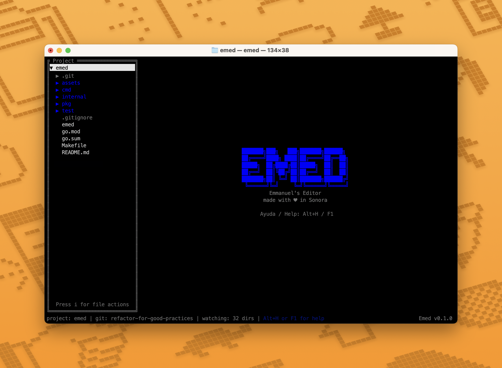
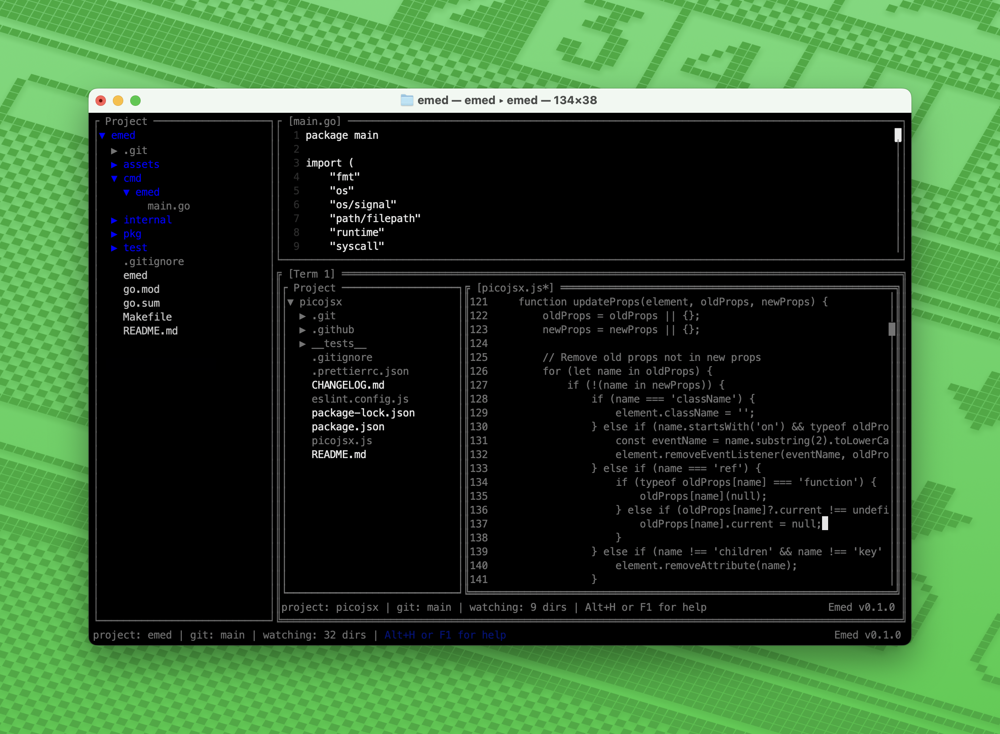
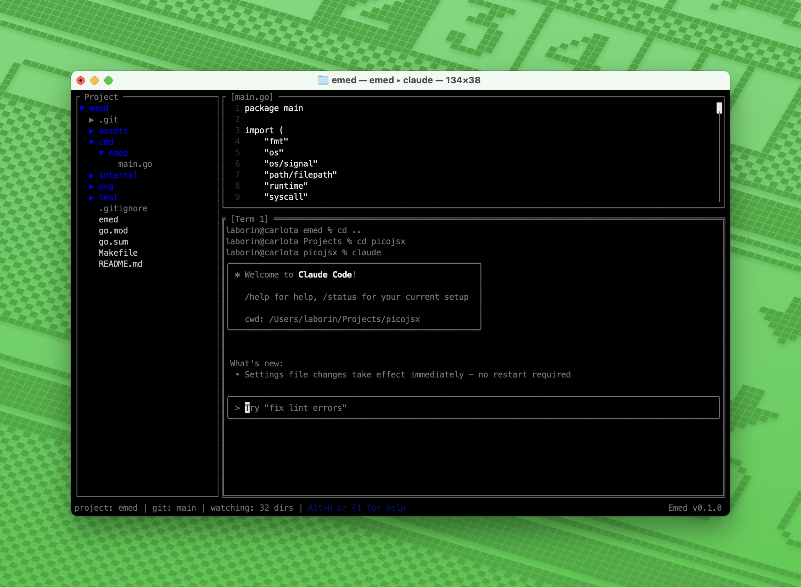
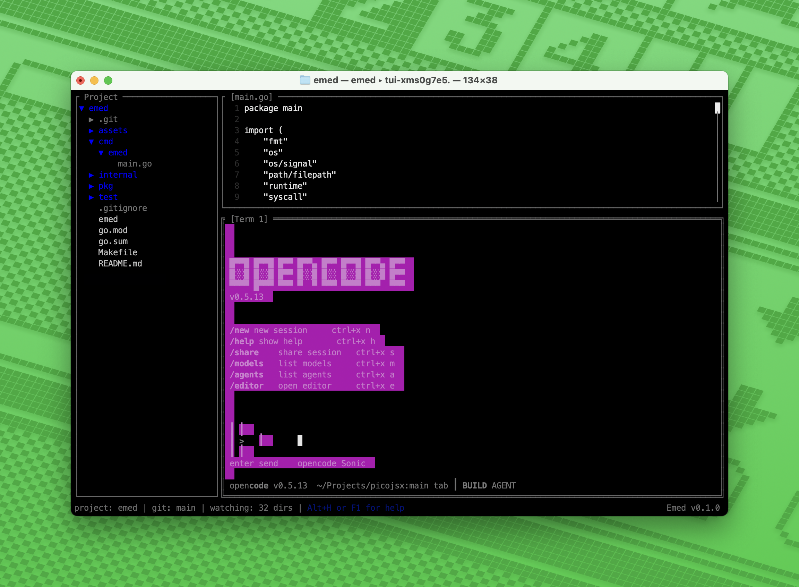

# Emed

## Motivation
I found myself wanting to code on my iPad, connected via SSh to a remote server. I don't like traditional terminal-based editors, they are too complex, I didn't wanted to remember dozens of keyboard shortcuts. Even micro was too complex, with all the panes and tabs and plugins. But I definitedly wanted more power than what nano could offer. Then, I imagined... I want a code editor that has a file manager on the left, a terminal on the bottom and a main area with tabbed documents, and intuitive keyboard shortcuts. I know, not original, this is the standard desktop IDE layout, but I could not find a single tool that offered this experience in the terminal without hours of initial configuration, learning and practice.

Then, I stumbled upon [tview](https://github.com/rivo/tview), and then made some research and found [chroma](https://github.com/alecthomas/chroma) and thought that creating my own TUI editor would be matter of just joining some pieces together (it was not). This was a great excuse to grab that Go book I purchased a couple of years ago when I was trying to get back to coding non-web stuff, and build something with a new language. This project was created as a learning exercise but aims to be a useful tool.

## Technical Description
Emed is built on top of the tview framework, which handles all the heavy lifting for the terminal UI. The layout is a simple flex container system that tview provides - nothing fancy, just three panels arranged how I wanted them. The file manager uses a custom horizontal-scrolling tree widget (htree) that I built from scratch because tview's TreeView couldn't handle long file names properly. It maintains the expansion state during refreshes and supports file operations like create, rename, delete, and clipboard operations.

The code editor is a custom tview primitive that handles text editing operations. Syntax highlighting is implemented using Chroma, with support for most languages. An early attempt was made with tree-sitter but it was too complex for such a tiny project like this. Before tree-sitter, the original, failed attempt was with Chroma, so the current implementation is the third attempt.

The terminal emulator has probably been the most fun and the hardest part to implement so far. I glued together creack/pty for pseudo-terminal handling and my fork of vt10x for VT100 emulation and escape sequence parsing. The tricky part was translating between vt10x's terminal state and tview's rendering system - especialy for colors, where I wrote a translation layer that handles ANSI colors (16 colors), 256 colors palette, RGB colors and even default FG and BG colors. Mouse events were another headache - I had to intercept and translate between tcell mouse events and terminal escape sequences. The scrollback buffer implementation was fun too, since I had to track when apps switch to alternate screen and vt10x was not very helpful to track lines that go out of screen, I added some helper code on my own fork to solve this. Its far from perfect and some TUI apps that uses specific escape sequences still render weird, but it's functional enough to run htop, nano, and even emed itself.

## The Plan
- [x] Simple 3-pane layout with easy keyboard navigation.
- [x] File manager in left panel with basic file operation (rename, delete, create files and dirs, copy, move paste files).
- [x] Fully functional terminal emulator on bottom panel.
- [x] Code editor, able to save files, responsive to external file changes, ready for syntax-highlighting using tview's color system.
- [x] File watcher to keep track of external changes on the project directory. Keeps the file manager in sync and updates unedited open tabs with new content.
- [x] Refactor for better file organization, modularity and best practices.
- [x] Implement syntax highlighting. Final implementation was made with Chroma after finding out tree-sitter was too complex.
- [ ] Implement project-wide and within-file search (using maybe [sahilm/fuzzy](https://github.com/sahilm/fuzzy) for project-wide fuzzy search, along a nice tview UI).
- [ ] Add some kind of integration with agentic AI tools.
- [ ] ???

## Screenshots
Emed's initial view:

Terminal panel open, running htop. Emed can handle medium complexity TUI apps on its embedded terminal.

A code file open. Syntax highlighting turned off, will be re-implemented with tree-sitter soon:

Inception. Running an emed instance in an emed terminal panel:

Running Claude Code in an emed terminal. I tried to translate rgb colors automatically, but mostly only ANSI colors are supported:

Struggles to render some specific apps, like OpenCode. This is going to improve by adding support for a wider set of escape sequences:

## Key bindings
### Global
- Ctrl+A: Focus file manager.
- Ctrl+E: Focus code editor.
- Ctrl+T: Focus terminal, creates a new terminal tab if none exists.
- F2: Cycles focus through file manager / editor / terminal.
- Ctrl+L: Cycles through pre-defined editor/terminal size proportions.
- Ctrl+P: Toggles terminal placement, bottom or right.

### File Manager
- Ctrl+Q: Exit emed.
- Ctrl+I: Shows file information panel.
- Arrow keys: browse project file tree.
- Enter: Opens the highlighted file on an editor tab.
- Ctrl+C: Copy reference of highlighted file to internal clipboard.
- Ctrl+X: "Cuts" highlighted file to internal clipboard (for moving).
- Ctrl+V: Pastes (copies or moves) the file in internal clipboard to the highlighted position.

### Editor
- Ctrl+S: Save file.
- Ctrl+C: Copy highlighted text to system clipboard.
- Ctrl+X: Cuts highlighted text to system clipboard.
- Ctrl+V: Pastes from system clipboard to cursor position.
- Ctrl+Shift+Left/Right: Browses through open tabs.
- Ctrl+W: Closes current tab.
- Word-by-word, line and pgup-pgdown navigation implemented but still erratic or inconsistent between platforms.

### Terminal
- Ctrl+W: Closes current tab.
- Ctrl+T: Opens a new terminal tab.
- Ctrl+Shift+Left/Right: Browses through open tabs.
- Alt+T: Toggles passthrough mode, where all keys and key combinations (except Alt+T) are sent to the terminal.

## Building

I added a Makefile to make building, debugging and testing easier. Here's how to use the basics:

- `make` or `make build` - builds the emed binary
- `make install` - builds and installs to /usr/local/bin (needs sudo)
- `make clean` - removes the binary and build artifacts
- `make dev` - builds with debug symbols for development

For cross-platform builds:
- `make build-linux`
- `make build-darwin` (MacOS, both Intel and Apple Silicon)
- `make build-windows`
- `make build-all`

## FAQ

**Q: Why?**  
A: One of my new year resolutions for 2025 was to code for fun again. A simple, easy to use terminal editor with decent features that does not require hours of reading and practice to use is a real need that I have.

**Q: Can I use it alerady?**  
A: I would not recommend it. It can edit files perfectly fine but its not stable yet, and without search implementes yet its not a pleasant experience.

**Q: Why "Emed"?**  
A: My name is Emmanuel, and it's my editor. But we could give the acronym other meanings, like "Extremely Mediocre Editor".

**Q: Why Go?**  
A: I had to put some unused knowledge in practice. This is personal, will write a post about this on my blog.
