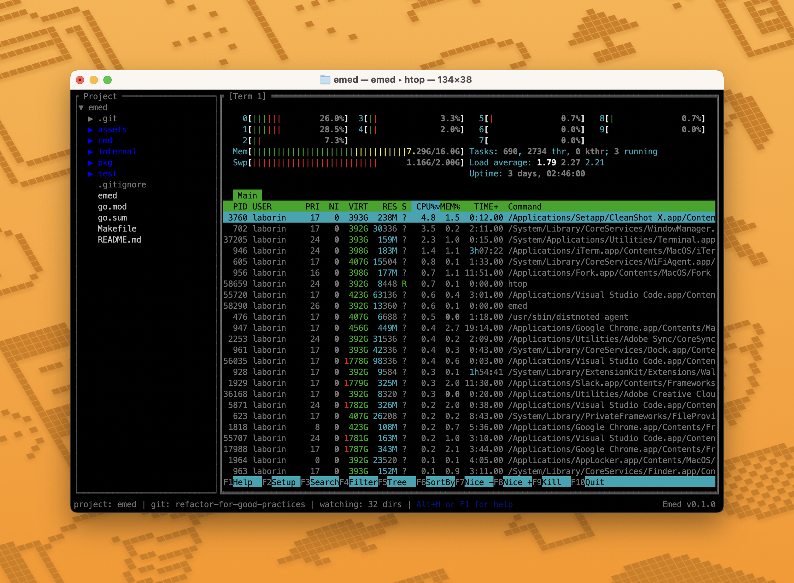
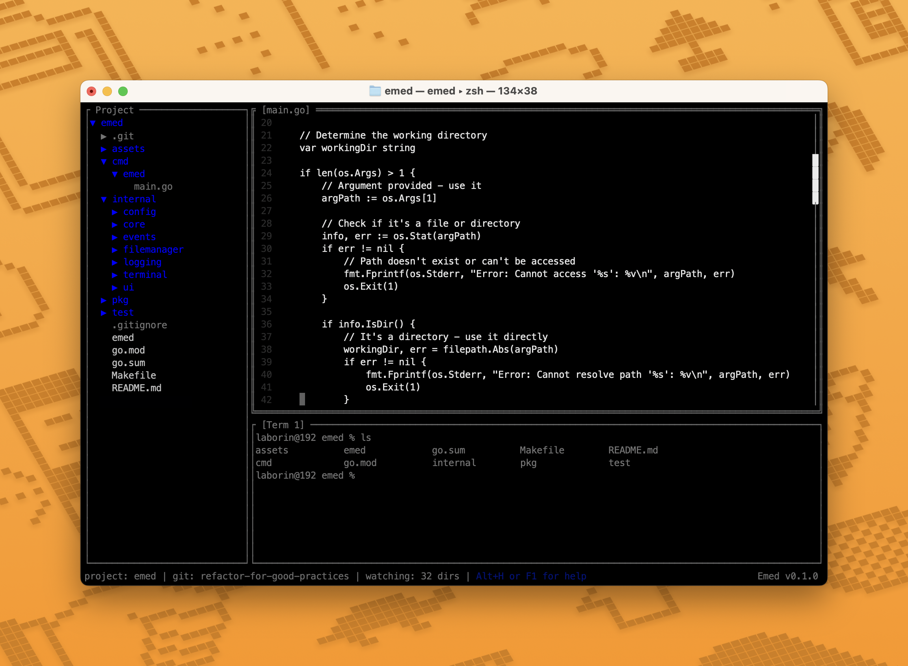

# Emed - Emmanuel's Editor

## Motivation
I found myself wanting to code on my iPad, connected via SSh to a remote server. I don't like the mainstream editors, they are too complex, I didn't wanted to remember dozens of keyboard shortcuts. Even micro was too complex, with all the panes and tabs and plugins. But I definitedly wanted more power than what nano could offer. Then, I imagined... I want a code editor that has a file manager on the left, a terminal on the bottom and a main area with tabbed documents, and intuitive keyboard shortcuts. I know, not original, this is the standard IDE layout, but I could not find a single tool that offer this without hours of initial configuration and learning.

Then, I stumbled upon [tview](https://github.com/rivo/tview), and then made some research and found [chroma](https://github.com/alecthomas/chroma) and thought that creating my own TUI editor would be matter of just joining some pieces together (it was not). This was a great excuse to grab that Go book I purchased a couple of years ago when I was trying to get back to coding non-web stuff, and build something with a new language. This project was created as a learning exercise but aims to be a useful tool.

## Technical Description
Emed is built on top of the tview framework, which handles all the heavy lifting for the terminal UI. The layout is a simple flex container system that tview provides - nothing fancy, just three panels arranged how I wanted them. The file manager uses a custom horizontal-scrolling tree widget (htree) that I built from scratch because tview's TreeView couldn't handle long file names properly. It maintains the expansion state during refreshes and supports file operations like create, rename, delete, and clipboard operations.

The code editor is a custom tview primitive that handles text editing operations.

## The Plan
- [x] Simple 3-pane layout with easy keyboard navigation.
- [x] File manager in left panel with basic file operation (rename, delete, create files and dirs, copy, move paste files).
- [x] Fully functional terminal emulator on bottom panel.
- [x] Code editor, able to save files, responsive to external file changes, ready for syntax-highlighting using tview's color system.
- [x] File watcher to keep track of external changes on the project directory.
- [ ] Refactor for better file organization, modularity and best practices. In pogress.
- [ ] Implement tree-sitter for syntax highlighting. A proof of concept was implemented using chroma but discarded in favor of tree-sitter for more features.
- [ ] ???

## Screenshots
Emed's initial view:

Terminal panel open, running htop. Emed can handle medium complexity TUI apps on its embedded terminal, including nested emed instances. Struggles with some apps like opencode:

A code file open. Syntax highlighting turned off, will be re-implemented with tree-sitter soon:

## Building

I added a Makefile to make building, debugging and testing easier. Here's how to use the basics:

- `make` or `make build` - builds the emed binary
- `make install` - builds and installs to /usr/local/bin (needs sudo)
- `make clean` - removes the binary and build artifacts
- `make dev` - builds with debug symbols for development

For cross-platform builds:
- `make build-linux`
- `make build-darwin` (MacOS, both Intel and Apple Silicon)
- `make build-windows`
- `make build-all`
